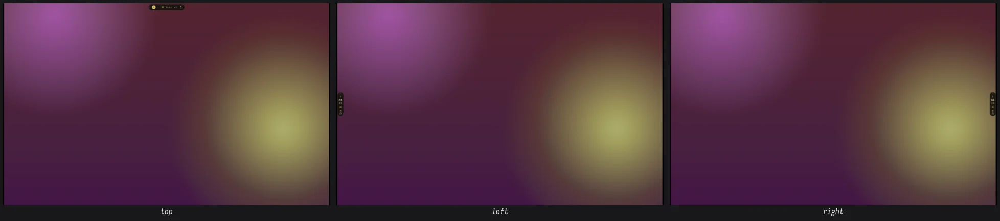
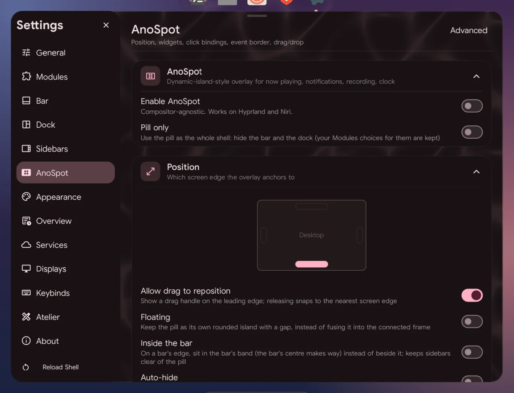

# The pill (AnoSpot)

The pill is AnoShell's dynamic island: a capsule on a screen edge that shows
what matters now (workspaces, the track, notifications, the clock), morphs
briefly for volume or a notification, and grows into panels when you click it.



## Pill bar style

In the Ano layout, `bar.style` decides what the bar is:

- `pill` (default): the pill is the bar. It rests at the **bottom centre**,
  carries the workspaces, clock, status and tray, and reserves its edge. The
  classic bar slides away.
- `classic`: the full bar, with the pill as an optional extra (`anoSpot.enable`).

Switching is live (Settings → Bar → Position & Style). Other layouts always
use the classic bar.

With `dock.position: auto` (default) the dock takes the edge opposite the pill.
Move the dock onto the pill's edge, or the pill onto the dock's, and the two
**swap** instead of stacking.

## Using it

| You do | It does |
|---|---|
| Left click | Media controls (`anoSpot.actions.leftClick`) |
| Right click | Control panel (`anoSpot.actions.rightClick`) |
| Middle click | Overview (`anoSpot.actions.middleClick`) |
| Wheel over the media | Volume |
| Horizontal scroll, or drag along it | Switch faces (status, media, spectrum, lyrics) |
| Press the grip (⋮⋮ at its start) | Edge picker: move to an edge (or click one) |
| Drop files on it | Stash them for actions (the shelf opens) |

With **Grow into** on for a panel, a click grows the pill into that panel
inline (the same panel, same state) instead of opening it separately; click
again or press Escape to shrink it back.

The [scratchpad](scratchpad.md) always grows out of the pill (Super+Y, or a
click action set to `"scratchpad"`), on the focused screen.

On the left and right edges the pill turns into a vertical capsule with a
stacked clock.

## Faces

Swipe between them; the capsule resizes to each. Status is always first; the
others appear when they have something to show.

- **Status**: workspaces, the track, recording, the latest notification,
  clock and weather, battery (and the tray as the bar). Live activities sit
  here too: a running timer (countdown, pomodoro or stopwatch, with the time
  left; click opens it) and a green or orange dot while the camera or the
  microphone is in use (hover for the app).
- **Media**: title, artist and transport.
- **Spectrum**: an audio visualiser. cava runs only while this face is in view.
- **Lyrics**: the current line of time-synced lyrics (Settings → Services →
  Lyrics), or "No lyrics for this track".

## The shelf

Dropping files on the pill opens the shelf: the dropped files with their
actions (LocalSend, Open, Copy path, Move to…, Reveal, your own), and below
them your pins and the newest copies and screenshots (`anoSpot.shelfSize`,
8 of each). Click an item to copy it (a picture goes in as a picture), drag
it out into another app (files and pictures as files, text as text), or pin
it with its corner pin. Pins are the clipboard's pins (kept across restarts
and a cleared history; a pinned screenshot is copied, so it outlives the
temporary file). Open it any time with `qs -c ano ipc call shelf toggle`, or
set a pill click to `"shelf"`.

## Transient states

The pill briefly morphs into a volume, brightness or microphone level capsule,
the keyboard layout, a notification, charging or recording, a finished
download or a screenshot, then returns to its face. Each can be turned off;
whatever the pill shows, the separate on-screen display doesn't.

"Recording saved", a finished download and "Screenshot taken" stay as long as
a notification; click the pill then to open the file. A transient isn't
replaced by a less important one: a notification waits behind them, and
charging behind them too; your own volume, brightness or layout change always
shows at once.

## Settings reference



Defaults as shipped. Settings → AnoSpot has all of them.

| Key | Default | What it does |
|---|---|---|
| `bar.style` | `"pill"` | Ano layout: `pill` (the pill is the bar) or `classic` |
| `dock.position` | `"auto"` | `top`/`bottom`/`left`/`right`, or `auto`: opposite the pill-bar |
| `anoSpot.enable` | `false` | The pill alongside the classic bar (always on as the pill-bar) |
| `anoSpot.position` | `"bottom"` | Edge: `top`, `bottom`, `left`, `right` |
| `anoSpot.widthPx` | `420` | Maximum length (at least 820 as the bar) |
| `anoSpot.heightPx` | `36` | Thickness |
| `anoSpot.hideOnFullscreen` | `true` | Slide into the edge over fullscreen windows; hover the edge to bring it back |
| `anoSpot.floating` | `false` | Its own floating capsule even when the connected frame is on |
| `anoSpot.inBar` | `false` | On a bar's edge, nest in the bar's band instead of beside it (not while floating) |
| `anoSpot.autoHide` | `false` | Stay tucked into the edge; pointing at the edge brings it out |
| `anoSpot.pillOnly` | `false` | Hide the bar and dock; the pill is all the chrome |
| `anoSpot.showWorkspace` | `true` | Workspace on the status face |
| `anoSpot.showMpris` | `true` | Track on the status face |
| `anoSpot.showRecording` | `true` | Recording indicator |
| `anoSpot.showNotification` | `true` | Latest notification |
| `anoSpot.showClockWeather` | `true` | Clock and weather |
| `anoSpot.showBattery` | `true` | Battery (hidden without one) |
| `anoSpot.showTimer` | `true` | A running countdown, pomodoro or stopwatch; click opens it |
| `anoSpot.showPrivacy` | `true` | Camera / microphone in use: a dot, the app on hover |
| `anoSpot.showLyrics` | `false` | Current lyric line in place of the track title |
| `anoSpot.accordion` | `true` | Track, notification and battery collapse to icons and open on hover |
| `anoSpot.modules` | `[]` | Bar modules (`drives`, `privacy`, …) on the status face, after the zones above; the same modules the bars use |
| `anoSpot.notificationTimeoutMs` | `4000` | How long a notification transient stays |
| `anoSpot.faces.media` | `true` | Media face |
| `anoSpot.faces.spectrum` | `false` | Spectrum face |
| `anoSpot.faces.lyrics` | `false` | Lyrics face |
| `anoSpot.growInto.mediaControls` | `false` | Grow into media controls |
| `anoSpot.growInto.controlPanel` | `false` | Grow into the control panel |
| `anoSpot.growInto.calendar` | `false` | Grow into the calendar |
| `controlPanel.tray` | `true` | The control panel (grown or on its own) has a row with every tray item and its menu, while an app has one |
| `controlPanel.capture` | `true` | The control panel has a Capture row: Shot (a region screenshot), Text (copy the text in a region) and Rec / Stop (a region recording) |
| `anoSpot.transients.volume` | `true` | Volume capsule |
| `anoSpot.transients.brightness` | `true` | Brightness capsule |
| `anoSpot.transients.mic` | `true` | Microphone mute |
| `anoSpot.transients.keyboard` | `true` | Keyboard layout |
| `anoSpot.transients.notification` | `true` | Incoming notifications |
| `anoSpot.transients.charging` | `true` | Plugged in / on battery |
| `anoSpot.transients.recording` | `true` | Recording started / saved (click opens it) |
| `anoSpot.transients.download` | `true` | A download finished (click opens it; needs anod) |
| `anoSpot.transients.screenshot` | `true` | A screenshot taken (click opens it) |
| `anoSpot.actions.leftClick` | `"mediaControls"` | Any panel IPC target |
| `anoSpot.actions.rightClick` | `"controlPanel"` | |
| `anoSpot.actions.middleClick` | `"anoview"` | |
| `anoSpot.actions.scrollOnMpris` | `"audio"` | Wheel over the track changes volume |
| `anoSpot.eventBorder.enable` | `true` | Glowing ring on events |
| `anoSpot.eventBorder.holdMs` | `1500` | How long it glows |
| `anoSpot.eventBorder.events` | `["notification", "track", "recording", "workspace"]` | Which events |
| `anoSpot.draggable` | `true` | Show the grip (edge picker) |
| `anoSpot.acceptDrops` | `true` | Accept dropped files |
| `anoSpot.stashDir` | `""` | Where dropped files go (empty: a cache folder) |
| `anoSpot.dropTargets` | `[]` | Your own drop actions |
| `anoSpot.shelfSize` | `8` | Newest copies and screenshots on the shelf, beside the pins (0: pins only) |
| `anoSpot.workspaceHoverPreview.enable` | `true` | Workspace preview on hover: live thumbnails under the chip, click one to focus it |
| `anoSpot.workspaceHoverPreview.allWorkspaces` | `false` | Every workspace's windows (labelled) instead of this screen's current one |
| `anoSpot.workspaceHoverPreview.openDelayMs` | `200` | |
| `anoSpot.workspaceHoverPreview.closeDelayMs` | `300` | |
| `anoSpot.workspaceHoverPreview.thumbnailWidth` | `180` | |
| `anoSpot.workspaceHoverPreview.thumbnailHeight` | `110` | |

## Dependencies

| Feature | Needs |
|---|---|
| Spectrum face | `cava` |
| Lyrics face | Lyrics in Settings → Services (local `.lrc` files, or the LRCLIB / NetEase lookup with `curl`) |
| Workspace preview | Hyprland (window capture) |
| Media | a player with MPRIS (most do) |
| Recording transient | a screen recorder (Settings → Services → Screen recording) |
| Download transient | anod |
| Shelf | `cliphist` + `wl-clipboard` (copies, pins) |

## From a terminal

```sh
qs -c ano ipc call config set anoSpot.position '"left"'
qs -c ano ipc call config set bar.style '"classic"'
qs -c ano ipc call recorder toggle
```
