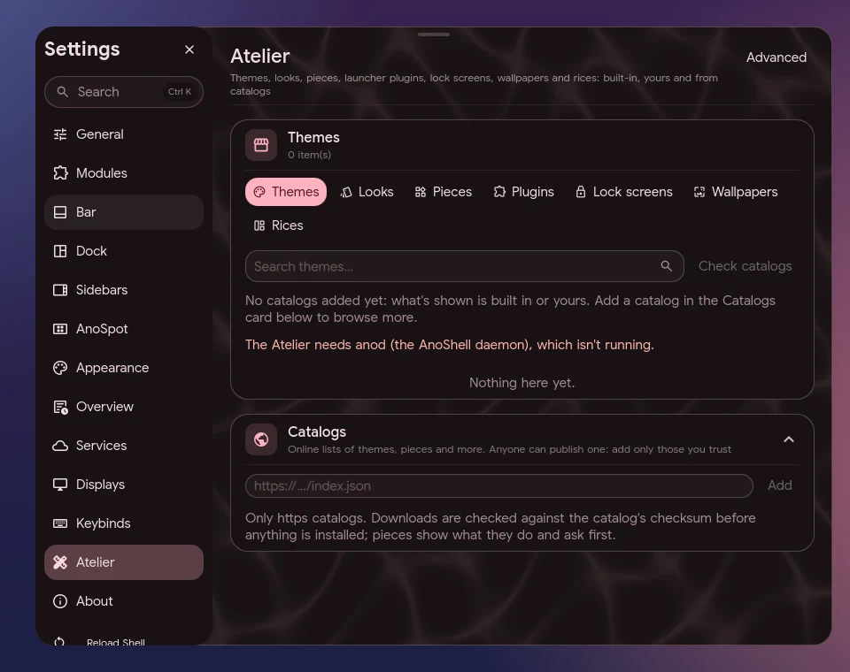

# Atelier

One place for shareable content: **themes**, **looks**, **pieces** (desktop widgets),
**launcher plugins**, **lock screens**, **wallpapers** and **rices** (a whole
setup). Open it at **Settings → Atelier**,
or from a terminal:

```sh
ano atelier              # the Atelier page
ano atelier wallpapers   # on the Wallpapers tab
```

With the shell's Settings overlay open, `ano atelier` switches it to the Atelier;
otherwise it opens the standalone Settings window. The Atelier needs anod (the
AnoShell daemon) running.



## Where items come from

Each tab merges three sources, and every card says which one it is:

| Label | Where | Notes |
|---|---|---|
| Built-in | shipped with AnoShell (`assets/themes/`, `looks/`, `pieces/`, `plugins/`, `lockscreens/`) | can't be removed |
| Yours | `~/.config/anoshell/<type>/` (wallpapers: your wallpaper folder) | your files: the Atelier never deletes them |
| Installed · *catalog* | installed from a catalog; a receipt in `~/.local/state/anoshell/atelier/receipts/` | can be updated and removed |
| *catalog name* | in a catalog, not installed yet | Install |

Theme cards show the theme's colours; wallpapers show the picture; catalog
items show their preview image when the catalog gives one.

## Applying

Installing never changes your setup; **Apply** is a separate button:

- **Themes** switch the colour theme (`appearance.theme.name`, static source).
- **Looks** set `appearance.look`.
- **Wallpapers** go through the normal wallpaper pipeline (colours included).
- **Pieces** are put on the desktop page you're on, at the first free spot
  (pieces must be on). A piece that fails to load shows its error
  instead.
- **Plugins** turn on or off in the launcher (`search.userPlugins`); see
  [Launcher plugins](plugins.md).
- **Lock screens**: **Use** sets `lock.screen`, **Preview** shows it on the
  focused screen without locking (nothing is checked; Escape closes it). See
  [Lock screens](lockscreens.md).
- **Rices**: see below.

## Wallhaven

On the Wallpapers tab, the Wallhaven card searches wallhaven.cc (empty search:
the latest) and installs a picture into your wallpaper folder's `atelier/`
subfolder with a receipt, so it shows as installed and can be removed here.
Results are safe-for-work unless your Wallhaven API key is set (Settings →
Appearance → Wallpaper, kept in the secrets folder and sent only as a header).
anod looks the picture up again itself before downloading and only accepts an
image from Wallhaven's own image host.

## Catalogs

A catalog is a JSON index on an `https://` address that lists items with
their download URL and SHA-256 checksum. Add or remove catalogs at the bottom
of the Atelier page (`atelier.catalogs` in `config.json`); **Check catalogs** fetches
them. Anyone can publish a catalog, so add only those you trust. Without a
network the Atelier shows what was fetched last and says the catalog is offline.

The AnoShell community catalog doesn't exist yet; until it does, the list
starts empty.

### Catalog format

```json
{
  "name": "My catalog",
  "items": [
    {
      "id": "weather-card", "type": "pieces", "name": "Weather card",
      "version": "1.2.0", "author": "someone", "licence": "MIT",
      "description": "Today's weather on the desktop",
      "preview": "https://example.org/weather-card.png",
      "url": "https://example.org/weather-card-1.2.0.tar.gz",
      "sha256": "<64 hex digits>",
      "hosts": ["api.open-meteo.com"], "commands": [],
      "changes": ["Hourly forecast", "Fixed the icon in light mode"]
    }
  ]
}
```

`id` (`a-z`, `0-9`, `-`), `type`, `url` and `sha256` are required; `compositor`
(`hyprland` or `niri`) limits an item to one compositor and `revoked: true`
withdraws it. `changes` is optional: what's new in this version, a string
(one line per newline) or a list of strings. It is shown as plain text, never
as markup: at most 20 lines of 300 characters, control characters dropped; any
other shape is ignored. The Atelier shows it as "What's new in 1.2.0" on the
item and on the update confirmation, and `ano atelier install` prints it.
`ano atelier pack` prints an entry to start from.

### What an install does

1. Downloads the item (https only) and checks it against the catalog's
   SHA-256. A mismatch stops here: nothing is installed.
2. Unpacks it into a staging folder next to its destination, refusing
   symlinks, device files, absolute paths, `..`, too many or too large files,
   and ids other than `a-z`, `0-9` and `-`.
3. For **pieces, plugins and lock screens** (code that runs with your
   rights, no sandbox), checks the
   files for risky patterns: downloading and running scripts, `sudo` or
   undeclared `pkexec`, writing to `~/.ssh`, `/etc` or your shell config,
   reading the secrets folder, touching the screen lock or PAM, binaries, and
   network hosts or commands the
   item doesn't declare. You see the author, the catalog, what it declares and
   what the check found, and choose **Install** (or **Install anyway**) or
   **Cancel**. The check is not a security audit, and neither is a catalog's
   review. An update that declares different hosts or commands asks again.
4. Moves it into place in one step and writes the receipt. Pieces, plugins
   and lock screens get a fresh folder per installed version (`<id>~<n>`), so an update never runs
   old cached code.

Nothing from an item is ever executed while installing: there are no install
scripts. If you changed an installed item's files, an update tells you which
ones before replacing them. A catalog can revoke an item: it can't be
installed any more, and installed copies are marked.

## Rices

A rice is a folder in `~/.config/anoshell/rices/<id>/` with a `rice.json`
(name, author, the settings it carries) and optionally its own themes, looks,
pieces, wallpapers and keybinds.

- **Apply rice** first snapshots your current setup, then merges only
  appearance settings, each checked against the setting's type (look, theme, bar style, pill position, piece layout
  and similar; never hooks, apps or commands), copies its files and sets its
  wallpaper.
- **Its keybinds** apply only when you tick that switch, and the page lists
  every bind first (commands it runs are highlighted). Only actions from the
  keybind catalogue are taken; raw Hyprland/niri binds, Lua helpers and
  submaps are left out and listed. A rice with keybinds or pieces counts as
  code, so installing one from a catalog asks first. A compositor layer (raw
  Hyprland or niri config) is not applied.
- **Undo** (named after the last rice and when you applied it, for 14 days)
  puts back only the settings that rice changed, so later changes to other
  settings stay; it removes the files the rice added and restores the ones it
  replaced. If you edited one of those files since, it says which and stops
  instead of overwriting your edit.
- **Export** saves what you have now as a rice: your appearance settings, your
  own theme or look, and the current wallpaper.

To publish one, `ano atelier pack <folder> --url-base https://…/` writes the
archive and prints the catalog entry with its checksum (see
[anod](anod.md) for the CLI and methods).
