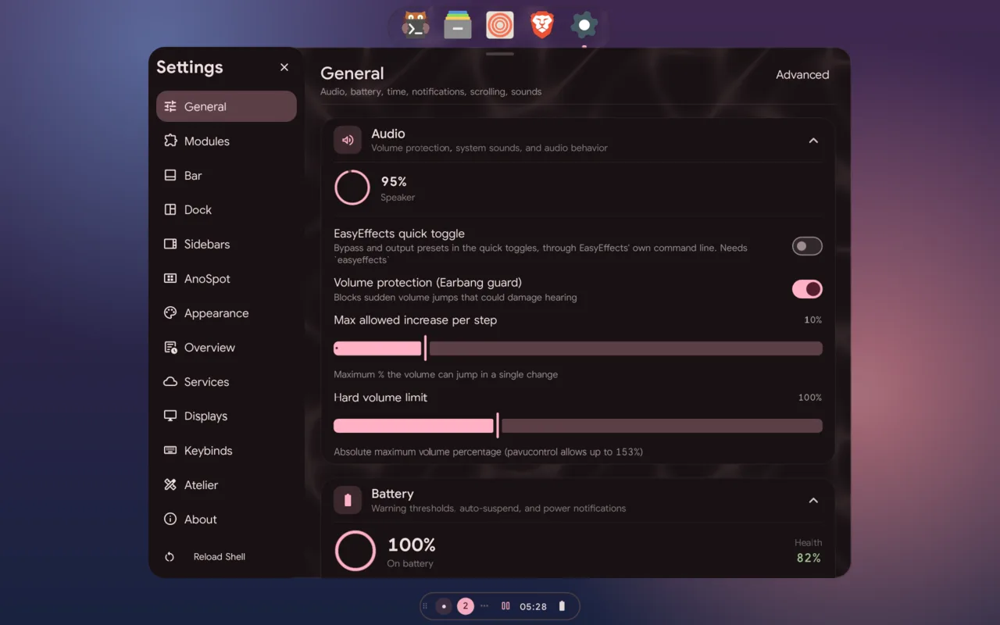
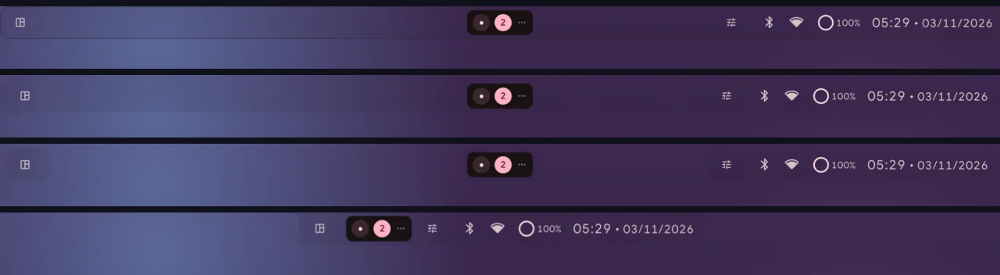
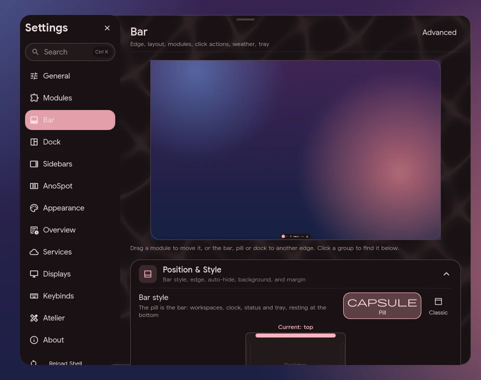

# Configuration

## Two files

| File | What it is |
|---|---|
| `~/.config/quickshell/ano/config.json` | the bundled defaults that ship with the shell. Nothing the shell does writes here |
| `~/.config/anoshell/config.json` | your per-machine **delta**: only the keys you changed. Settings writes here |

On start the shell reads the bundled defaults and deep-merges your delta on top:

- Objects merge key by key, so setting `bar.layout.height` leaves the rest of
  `bar` alone.
- Arrays and plain values replace the default entirely.
- Removing a key from your file brings back the default.
- Because the file is sparse, it's portable to another machine, and new
  defaults in a shell update reach you for every key you haven't changed.

You can edit the file by hand; the shell watches it and applies saves without a
restart. A file that isn't valid JSON gets a notification with the line and
column of the error, and the last good config keeps applying.

```json
{
  "bar": { "form": "islands", "layout": { "height": 38, "radius": 16 } },
  "anoSpot": { "enable": true, "position": "bottom" },
  "appearance": { "connectedCorners": { "enable": true } }
}
```

Check a hand-edited file with `ano config validate`, and bring an old one up
to date with `ano config migrate` (see [The `ano` CLI](cli.md#config)).

## Settings



Open Settings with `ano ipc call settings toggle` (bound to `Super+,` in the
bundled Hyprland config), or as a standalone window with
`qs -n -p ~/.config/quickshell/ano/settings.qml`. Both use the same pages and
open on About. `anod/install.sh` also adds **AnoShell Settings** to your app
launcher (`~/.local/share/applications/anoshell-settings.desktop`). The
standalone window has its own app id, `anoshell-settings`, and icon; the
bundled Hyprland and niri configs float it.

| Page | Config keys it owns |
|---|---|
| About | `user` |
| General | `audio`, `battery`, `time`, `notifications`, `interactions`, `sounds.battery`, `sounds.volume`, `sounds.login`, `sounds.notifications`, `sounds.panels`, `sounds.alerts`, `sounds.alertThreshold`, `sounds.alertGap`, `session` |
| Modules | `disabledPanels`, `panelFamily`, `familyTransitionAnimation`, `osd`, `screenCorners`, `altSwitcher`, `apps`, `focusTime`, `taskView`, `media`, `compositor`, `hacks`, `displayManager`, `display.primaryMonitor`, `sounds.theme`, `bar.morphingPanels` |
| Bar | `bar`, `bars`, `tray` |
| Dock | `dock` |
| Sidebars | `sidebar` |
| AnoSpot | `anoSpot` |
| Appearance | `appearance`, `background`, `animations`, `settings.softenWallpaper` |
| Overview | `overview` |
| Services | `ai`, `autostart`, `gameMode`, `performance`, `powerProfiles`, `network`, `vpn`, `nightLight`, `lyrics`, `calendar`, `resources`, `light`, `shell`, `weather` |
| Displays | `cursor`, `icons` |
| Keybinds | `keyboard` |
| Atelier | `atelier` |
| Actions | `actions` |

- **Search** at the top of the page list (or `Ctrl+K`) searches every setting
  by its label, description or config key, ignoring case, punctuation and
  spaces ("wifi" finds Wi-Fi); Enter jumps to the card that owns it. Typing a
  letter or digit while no field has focus starts a search with it.
- `Ctrl+1` … `Ctrl+9` jump to a page; `Esc` closes.
- `Ctrl+Z` undoes the last change made while Settings is open, resets
  included (up to 50), and a toast names the key. A key that was at its
  default goes back out of your file. A text field with focus undoes its own
  text first. `qs -c ano ipc call config undo` does the same, and
  `config reset <key>` puts one key back to its default.
- **About → Errors** lists the QML warnings and errors the running shell
  logged, deduplicated with counts (newest first; Refresh, and every 10 s
  while it's open). Their number shows next to About in the page list. It
  reads Quickshell's log through anod (`shell.errors`), so it needs anod;
  `ano doctor` reports the same count.
- **Previews you can edit** sit at the top of some pages and change the real
  shell as you go (written once, when you let go):
  - **Bar** and **AnoSpot**: a miniature of your screen with the bar, pill and
    dock as they are. Drag a module within or between groups, or the bar, the
    pill or the dock to another edge; click a group to find it in the editor.
  - **Appearance** and **Atelier**: every theme drawn in its own colours and
    every look in its own shape, material and type, as a small desktop; the
    Look card can show them in a dark or a light palette.
  - **General → Lock screen**: the chosen lock screen in miniature. In the
    built-in one, drag the clock, your name, the status row or the password
    field anywhere, and resize one by its round handle (`lock.layout`);
    **Reset layout** puts them back in the centred column.
  - **General → Notifications** and **Modules → OSD**: drag the notifications
    to a corner or an edge, their side handle for their width
    (`notifications.popupWidth`), or the volume OSD up or down.

  [Watch a module dragged in the bar preview (WebM)](images/bar-preview.webm)
- Each page's **Reset** clears only the keys that page owns from your delta.
  **Reset every setting** on the About page clears the whole delta. Neither
  writes defaults into your file.

## Bars




Bars are defined in the `bars` array. Each bar sits on an edge (`top`,
`bottom`, `left` or `right`) and has its own modules; `bar.*` holds the
defaults every bar falls back to.

An auto-hidden bar (`bar.autoHide.enable`) shows when the pointer rests at
its edge for `bar.autoHide.revealDelay` (150 ms), so passing over the edge
on the way to a browser's tabs doesn't pull it out; it stays for
`bar.autoHide.delay` after the pointer leaves. The dock works the same way
(`dock.revealDelay`, 150 ms), and with `dock.magnify` (on) its icons swell by
distance from the pointer and lift off the edge. Pinned or not, the dock hides
while a fullscreen window is up.

### Forms

`bar.form` (or `form` on one bar) shapes the whole bar:

| Form | Shape |
|---|---|
| `full` | edge to edge (the default) |
| `fit` | inset from the screen edges, floating |
| `islands` | every group is its own pill |
| `notch` | all groups packed in the middle; the bar hugs its content |

`fit` and `islands` sit `bar.layout.formMargin` (6 px) off the screen edge.
Switching forms animates.

### Groups

A bar's modules are arranged in **groups**. Each group has an id, a zone
(`start`, `center` or `end`), its modules, and whether it is attached to the
bar body:

```json
{
  "bars": [{
    "id": "main",
    "edge": "top",
    "form": "full",
    "groups": [
      { "id": "start",  "zone": "start",  "modules": ["sidebarButton", "activeWindow"], "attached": true },
      { "id": "center", "zone": "center", "modules": ["workspaces"], "attached": false },
      { "id": "end",    "zone": "end",    "modules": ["clock", "battery", "network", "tray"], "attached": true }
    ]
  }]
}
```

- A detached group (`"attached": false`) becomes its own island, with
  `bar.layout.groupGap` (10 px) opened on each side. In the `islands` form every
  group is detached.
- Attached groups sit `bar.layout.groupSpacing` (8 px) apart.
- A bar without `groups` uses its older `modules.left/center/right` lists as
  three groups (start, center, end); the first edit through Settings or the
  group menu saves them as `groups`.

Edit groups on the **Bar** page (pick the form, detach groups, drag modules
between groups), or right-click a group on the bar for **Detach group** /
**Attach group** and **Customize bar…**.

Bar modules: `sidebarButton`, `activeWindow`, `workspaces`, `clock`,
`weather`, `battery`, `network`, `bluetooth`, `tray`, `media`, `resources`,
`keyboard` (also `keyboardLayout`), `notifications`, `idle`, `privacy`,
`drives`, `gamemode`, `nightlight` (click toggles, scroll sets the
temperature), `downloads` (shown while a browser downloads into your
download folder: size and rate; finished ones open the file or folder). Any of them can also sit on the pill
(`anoSpot.modules`).

`bar.workspaces.hoverWindows` (off by default): hovering a workspace button
shows that workspace's windows as live thumbnails; clicking one goes to the
workspace and focuses the window.

`dock.previews` (on by default): resting the pointer on a running app in the
dock for a moment shows its windows (up to six) as live thumbnails with their
titles, above the icon (beside it on a side dock). Click one to focus it,
middle-click to close it. The dock stays up while the pointer is on them.

Pinned apps (`dock.pinnedApps`) keep the order you give them: press a pinned
icon and drag it along the dock (a short wobble still counts as a click), or
use the up/down arrows in Settings → Dock → Pinned Apps.

## Network panel

`network.panelStyle` picks what the network and Bluetooth entry points open:

| Value | Opens |
|---|---|
| `"classic"` (default) | The inline pickers: the bar popouts pin open with the Wi-Fi / Bluetooth list, and the sidebar chevrons expand them. |
| `"orbit"` | **Network Orbit**, an animated panel adapted from ilyamiro's network popup. |

Set it on **Settings → Services → Network panel**. With `"orbit"`:

- Clicking the bar's `network` module opens Orbit on Wi-Fi (Ethernet when
  wired), and clicking `bluetooth` opens it on Bluetooth. Click again to close.
- The right sidebar's Wi-Fi and Bluetooth chevrons open it on that tab.
- Right-clicking the control panel's Wi-Fi or Bluetooth toggle opens it.

Network Orbit has a tab per available connection type: Ethernet, Wi-Fi,
Bluetooth, and VPN (when a provider is set under `vpn.providers`).

- **Cores:** connected devices glow in the middle. Several Bluetooth devices
  orbit each other.
- **Cards:** networks and devices you can connect to orbit around the cores.
  Once you're connected, the cards show the connection's details instead.
  **Scan** / **Current device** switches between the two.
- **Press and hold** a card to run it: connect, pair, copy the IP, sign in to a
  portal, forget the network, or unpair the device. Press and hold a core to
  disconnect it.
- **Password:** a secured Wi-Fi network that needs a password asks for it in
  the core. Enter connects, and Escape cancels.
- **Power:** the power button turns the tab's radio on or off. On the VPN tab
  it connects or disconnects, or opens the sign-in link when the provider asks
  for one.
- **Keys:** Tab cycles the tabs, and Escape closes the panel.

The panel is the `anoNetworkOrbit` module (Overlays, in the ano and hefty
families). Its IPC target is `networkOrbit`:

```sh
ano ipc call networkOrbit open wifi     # wifi | bt | vpn | eth
ano ipc call networkOrbit toggle bt     # "" toggles whatever tab is open
ano ipc call networkOrbit close
```

### Wired & tethering

The bar's `network` popout and the right sidebar's network card list every
non-Wi-Fi link under **Wired & tethering**: ethernet, USB tethering (a phone
whose USB driver is RNDIS, CDC Ethernet/NCM or Apple's ipheth), Bluetooth
tethering and mobile broadband. Each row shows the link's type icon, name,
state and IPv4 address, and a link button connects or disconnects it
(`nmcli device connect|disconnect`). The one the default route goes through
(the lowest metric in `ip route show default`) has a **Traffic** badge, and
the bar icon shows its type. The section is hidden when there are none.

Container, VM, bridge and tunnel interfaces (`docker`, `veth`, `vboxnet`,
`virbr`, `br-`, `tun`, `wg`…) are never listed and never count as
"Ethernet" for the bar icon; VPNs have their own row. The list refreshes on
`nmcli monitor` events. Needs `nmcli` and `ip` (iproute2).

### NetworkManager VPNs

VPN and WireGuard connections you set up in NetworkManager
(nm-connection-editor, `nmcli connection import`) are listed in
Settings → Services → NetworkManager VPNs with a switch each
(`nmcli connection up|down`). A VPN type needs its NetworkManager plugin
(e.g. `networkmanager-openvpn`). While one is up the bar's network icon shows
a small shield and its popout names the connection. The list follows
`nmcli monitor`, like the wired links.

Wi-Fi state and the network list come live from Quickshell's
`Quickshell.Networking` module (NetworkManager over D-Bus), so nothing is
re-read when they change; `nmcli` still runs scans, connects and the hotspot.

### NetBird

With `vpn.providers` set to NetBird, the right sidebar's Network card shows
the management and signal servers (with their errors), your NetBird IP and
FQDN (copy buttons), and how many peers are connected. It checks every 30 s,
every 2 s while the sidebar is open, and backs off to 5 min while the NetBird
service is down; `vpn.notifyOnChange` announces a management or signal
change.

- **Exit node:** choose **Direct** or one of your exit nodes (networks routing
  `0.0.0.0/0`). Only one is used at a time; choosing one deselects the others.
- **Networks:** each routed network has a switch (`netbird networks select -a`
  / `deselect`).
- **Profile:** your NetBird profiles (`netbird profile list`); choosing another
  one disconnects, selects it and reconnects.
- **Self-hosted server:** Settings → Services → VPN → NetBird management URL
  and admin URL (`vpn.netbird.managementUrl` / `adminUrl`) are passed to
  `netbird up` when you connect from the shell; empty keeps the server the
  profile already uses. When NetBird needs you to log in, its login page opens
  in your default browser.
- The bar's network icon carries a small shield while the VPN is up, filled
  while traffic goes out an exit node; its popup names the exit node.

## Overview and switchers

The overview (Super+Tab, `qs -c ano ipc call anoview toggle`) lays windows out
in the layout picked on Settings → Overview (`overview.layout`); the task view
(Super+Grave) has its own (`taskView.layout`).

`overview.liveThumbnails` (Settings → Overview): `off` (default, one still
frame per window), `hovered` (only the hovered or selected window streams) or
`all` (the first 12 stream). It covers the overview, the task view and the
Alt+Tab list, and streams only while the view is open; the fan switcher is
always live. Window capture needs Hyprland.

## anod hooks

Event hooks for anod live under `hooks` in the same file. See
[anod → Event hooks](anod.md#event-hooks).

## Location

`location` (Settings → Services → Location) is where you are, for the bar's
weather, night light's sunset-to-sunrise schedule and the sun and moon of the
Bioma pieces:

- `enable` (on): off looks nothing up; the weather then uses
  `bar.weather.city`, or wttr.in's guess from your IP address, and the
  sunset schedule waits.
- `mode` `"auto"` (default): GeoClue through Qt Positioning (needs the
  `geoclue` service and `qt6-positioning`; Wi-Fi or GPS as GeoClue is set
  up). If it gives nothing within 20 s or refuses, the IP address through
  ip-api.com (`curl`; city-level, and it sends your IP address to them),
  looked up again every 2 hours. `"manual"`: `city`, `latitude` and
  `longitude` as you set them.

`qs ipc call location get` prints what's known; `refresh` looks again.

## Weather warnings

`bar.weather.alerts` (Settings → Bar → Weather):

- `enable` (on): anod fetches official warnings for your location and
  notifies each new one; active ones show as a badge by the bar's weather
  and in the weather panel. Feeds (free, no key): NWS (US), MET Norway,
  DWD via Bright Sky (Germany), MeteoAlarm (the rest of Europe, matched by
  area name). Nowhere else has one. The country comes from a Nominatim
  (OpenStreetMap) reverse geocode, once per place: it sends your
  coordinates there, and the feed's request sends them to that service.
  Needs anod and a known location.
- `rain` (off), `rainThreshold` (60 %), `rainHours` (3): one notification
  when wttr.in's hourly chance of rain reaches the threshold within that
  many hours.
- `quiet` (off), `quietFrom` / `quietTo` (`"22:00"`–`"07:00"`): in quiet
  hours both go to the notification history without a popup; extreme
  warnings still pop up.
