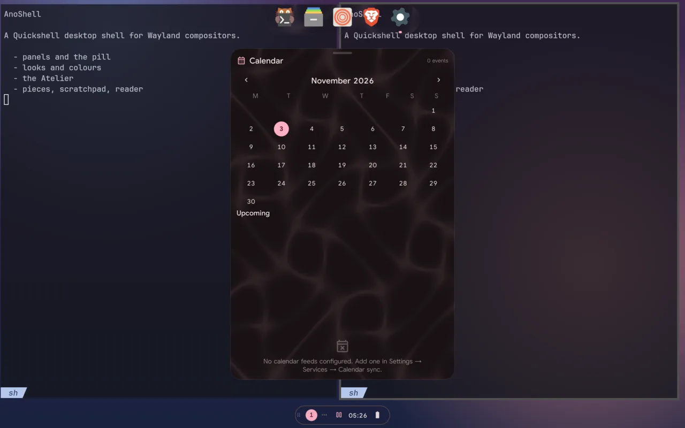
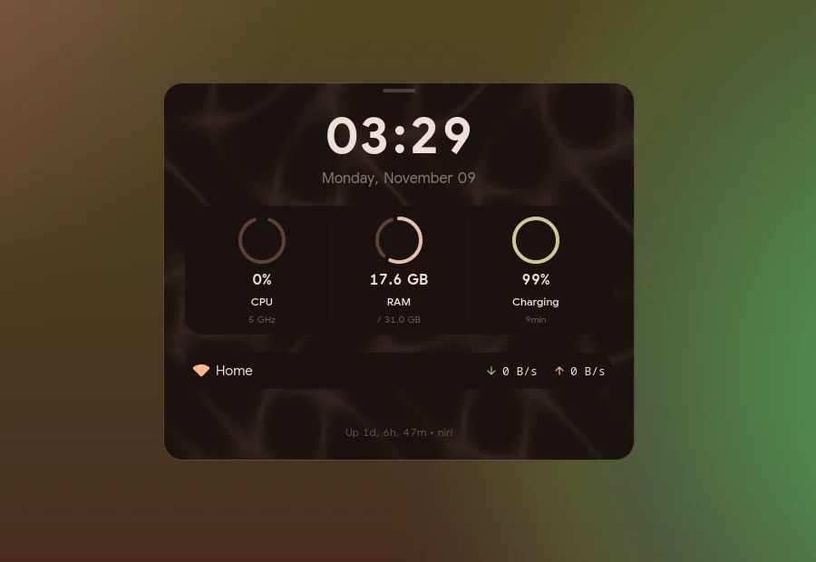
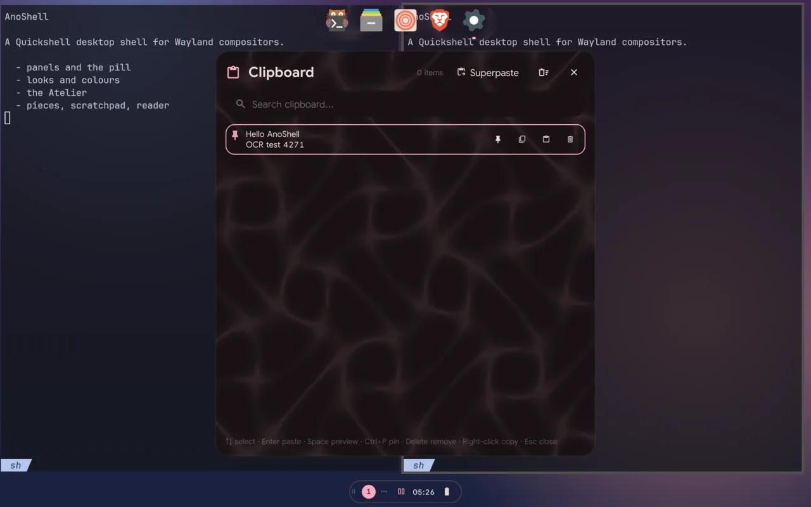
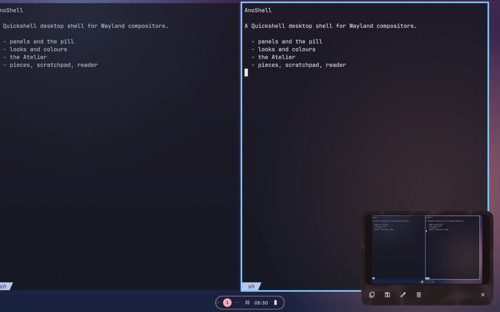
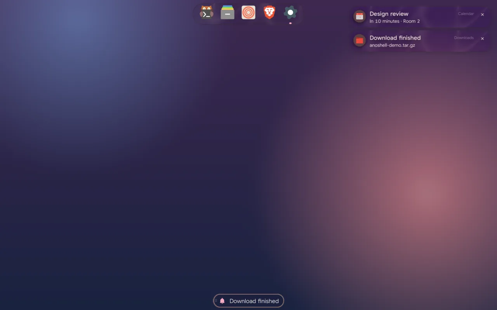

# Launcher providers and productivity

Everything here is **off until you turn it on**. While off, nothing is
created, read or run.

## Launcher providers

Settings → Modules → **App Launcher**. Results appear above your apps, and the
arrow keys and Enter work across both.

| Provider | Key (`search.plugins.…`) | How to use it | Needs |
|---|---|---|---|
| Calculator | `calculator.enable` | type a sum or a conversion (`2+2*3`, `5 km to mi`); Enter copies the answer | `qalc` (libqalculate) |
| Emoji | `emoji.enable` | type a name (`fire` → 🔥); `:` alone lists only emoji; Enter copies | nothing |
| Packages | `packages.enable` | `pkg firefox`; Enter installs it in your terminal | `paru` or `yay` (`packages.helper` picks one) |
| Actions | `actions.enable` | type an action's name: Lock screen, Suspend, Reboot, Power off | nothing |
| Colour schemes | `schemes.enable` | `scheme …` switches the Material variant (tonal-spot, rainbow…) or a fixed theme, live | anod (for the variant) |
| Looks | `looks.enable` | `look …` switches the look, live | nothing |

**Actions** come from `search.plugins.actions.items`. Each item has a `name`,
an `icon` (Material Symbols), a `command` (an argument list, never run through
a shell) and `dangerous`. A dangerous action (reboot, power off) is refused,
with the reason shown, until you turn on `actions.enableDangerous`.

```json
{ "name": "Restart Wi-Fi", "icon": "wifi", "command": ["nmcli", "radio", "wifi", "off"], "dangerous": false }
```

`ano doctor` warns when a provider is on but its tool is missing.

## Productivity




Settings → Sidebars → **Productivity**.

- **Notepad** (`notepad.enable`): tabs of text in the right sidebar, saved
  as you type to `~/.local/share/anoshell/notepad.json`. A tab is named after
  its first line.
- **To-do** (`todo.enable`): a list kept in a todo.txt (one task per line,
  `x <date> ` in front when it's done). The file is `todo.file`, or
  `~/.local/share/anoshell/todo.txt` by default. Edit it in any editor and the
  sidebar updates at once; changes made in the sidebar are written straight
  back. Tick a task and it strikes through, then folds under **Done**;
  double-click a task to edit it; remove one and **Undo** brings it back for a
  few seconds. todo.txt markup shows as chips: `(A) ` priority (A red, B
  tertiary), `due:2026-10-25` (or `due:today`, `due:tomorrow`, `due:fri`),
  `+project` and `@context`.
- **Pomodoro and stopwatch** (`pomodoro.enable`): focus, short break and long
  break (`focusMinutes`, `breakMinutes`, `longBreakMinutes`,
  `cyclesBeforeLongBreak`), with a notification at each change. It is separate
  from Focus Time: it doesn't turn on Do Not Disturb or track apps.
- **Sticky note** (`stickyNotes.enable`): a note on the desktop, kept in
  `~/.local/share/anoshell/sticky.md`. With **click-through**
  (`stickyNotes.clickThrough`), clicks go to the windows below, except on its
  pin, which turns click-through off again. Also
  `qs -c ano ipc call stickyNote clickThrough`. Its place and size are
  `stickyNotes.x`, `y`, `width` and `height`.

## Removable drives

The module `drives` (add it to any bar in Settings → Bar, or to the pill in
Settings → AnoSpot → Bar modules) appears while a USB stick, SD card or other
hot-pluggable disk is plugged in. Its popout lists each drive and its
partitions: **Mount** / **Unmount**, **Open** (your file manager) and
**Eject**, which unmounts everything and powers the drive off. While data is
still going to a drive the icon spins and the drive says *Writing … MB/s ·
not safe to remove*, with how much the system still has to write; during
Eject it says *Ejecting…* until the data is on the drive. A notification
says when a drive is plugged in and when it's safe to remove
(`drives.notify`, Settings → Services). `qs -c ano ipc call drives list`
prints the state; `mount`, `unmount` and `eject` take a device path.

## KDE Connect

Your phone through KDE Connect, off by default: **Settings → Services → KDE
Connect** (`kdeConnect.enable`). It needs `kdeconnectd` running (the bundled
Hyprland and niri configs start it; the shell never does) and a phone paired
from the KDE Connect app.

- The bar module **Phone** (`kdeconnect`) shows the phone and its battery;
  its popout lists paired devices with **Ring**, **Ping**, **Clipboard** (send
  yours) and **File…** (pick one with `zenity`).
- A pairing request from a phone shows a notification with Accept and Reject.
- With more than one paired device, `kdeConnect.device` picks the one the bar
  and actions use (empty: the first reachable one).
- `qs ipc call kdeConnect status | ring | ping | sendClipboard | refresh`.

The shell follows kdeconnectd's D-Bus signals and asks again only about the
device a signal names; nothing polls. Every call gives up after 5 s, so a
kdeconnectd that runs but doesn't answer is shown as "not answering" (restart
it) and asked again every minute. Off, nothing runs.

## Privacy indicator

The bar module `privacy` shows a red icon while the microphone, a camera or
the screen is being captured, and its tooltip names who: microphone and
camera use through PipeWire (by the app's stream, so virtual sources such as
EasyEffects' count too), cameras opened directly (anod watches `/dev/video*`
with inotify and reports a holder after 1.5 s, so an app only probing a
camera doesn't show), and screen captures (Hyprland's screencast events,
after 0.7 s so a screenshot doesn't show; portal casts also through
PipeWire). `qs -c ano ipc call privacy uses` prints the same list.

A browser sharing **one of its own tabs** captures it internally, with no
portal, PipeWire stream or compositor event, so nothing on the desktop can see
it and the indicator stays off; sharing a window or the screen shows.

## Password prompt (polkit)

When an app needs permission (pkexec, mounting a disk, a system setting),
AnoShell asks for your password on the focused screen: Enter authenticates,
Esc or Cancel says no. **Details** shows the polkit action, its description
and vendor (from `pkaction`) and, for pkexec, the full command waiting to run
and what started it.

Settings → General → Password prompt:

- `polkit.enable` (on): polkit takes one agent per session, so if another
  one (hyprpolkitagent, polkit-gnome…) is already running, AnoShell's stays
  quiet and the card says so. AnoShell never stops other agents; stop yours,
  then press **Retry**.
- `polkit.blur` (off): blur behind the prompt. Off, the prompt uses the
  namespace `quickshell:polkitPlain`, which the bundled Hyprland and niri
  configs leave unblurred (add the same rule to your own config if you don't
  use the bundled one).

## Clipboard history



Alt+V opens the clipboard history (cliphist). Entries show what they are:

- **Images** as thumbnails at their own shape, with type, size and weight.
- **Copied files** (from a file manager) as tiles: image files and a frame
  from each video (with a play badge), an icon for audio, PDFs and the rest.
- **Colours** (`#rrggbb`) with a swatch.

Previews are made only for rows in view, two at a time, under
`/tmp/quickshell-anoshell/media/cliphist` (cleared when the shell starts;
an image's preview goes when its entry does). Space, or the corner button,
opens a large preview; for a video, **Play** opens it in your default player.

**Pins** (the pin button, or Ctrl+P) keep an entry at the top, apart from the
history in `~/.local/share/anoshell/clipboard-pins.json` (pinned images are
copied to `clipboard-pins/` beside it), so clearing the history keeps them.
Unpinning removes the copy.

Keys: ↑↓ select, Enter pastes, Space previews (search empty), Ctrl+P pins
or unpins, Delete removes the selected entry or unpins a pin (search empty);
Esc closes the preview, then the panel. Right-click copies without pasting.

**Passwords stay out.** A copy marked sensitive (a password manager's copy,
or `wl-copy --sensitive`) is never stored: wl-paste passes it on as
`CLIPBOARD_STATE=sensitive` and `cliphist store` (0.7.0) skips it. This needs
the bundled watch lines (`wl-paste --watch … cliphist store`), or your own,
to run `cliphist store` with the environment intact.

## Screenshots



Print (screen), Shift+Print or Super+Shift+S (region), Ctrl+Print (the focused
window), or `qs -c ano ipc call screenshot region|window|screen`, and
`screenshot delayed <mode> <seconds>` for a countdown. On Hyprland they use
slurp and grim; on niri, niri's own screenshot actions. The image goes on the
clipboard (`screenshot.copyOnCapture`) and a card shows it: Copy, Save (to
`screenshot.saveDir`, or Pictures/Screenshots), Edit (satty, else swappy),
Delete, Close. It leaves after `screenshot.previewSeconds` (0 = stays) unless
the pointer is on it; `screenshot.onTimeout` then keeps the temp file, saves
it or deletes it. The card sits at `screenshot.previewEdge`.

With `screenshot.freezeRegion` on (Settings → Modules → Screenshots), a region
capture first takes each screen and shows it still while you drag, so the shot
is the moment you pressed the key, not whatever moved meanwhile (Hyprland and
other wlroots compositors; niri uses its own picker).

### Text recognition (OCR)

Super+Shift+X, or `qs -c ano ipc call screenshot ocr`: pick a region and its
text goes on the clipboard. The card then shows the text (selectable) with
Copy, **Add to note** (the end of the current notepad tab; needs the notepad
on) and **Pin** (kept with the clipboard pins). It reads with `tesseract` in
the languages of `screenshot.ocrLanguages` (default `["eng"]`; Settings →
Modules → Screenshots), each needing its `tesseract-data-<code>` package. The
picture is deleted once it's read. No text, no tesseract or a missing language
each give a notification saying which, and leave the clipboard alone;
`ano doctor` checks tesseract and the languages.

## Screen recording

`qs -c ano ipc call recorder region|screen|stop|discard` (Super+Shift+R and
Super+Shift+Alt+R in the bundled binds) record with the recorder picked in
Settings → Services → Screen recording (gpu-screen-recorder, wl-screenrec or
wf-recorder; auto takes the first installed). `recording.fps` sets the frame
rate (30/60/120) and `recording.audioSource` the sound: none, system (what you
hear), mic, or both. gpu-screen-recorder mixes both itself; with the other two
the shell loads a temporary null sink and two loopbacks for the recording and
unloads exactly those afterwards, leaving your audio setup as it was.

While recording, a small floating indicator shows the time with Stop, Discard
(stops and moves the file to the trash), and mute buttons. When it's saved, a
notification shows the first frame with Open, Show in folder and Delete.
Recordings go to `recording.dir` (empty: ~/Videos).

## Screen time

`screenTime.enable` (Settings → Sidebars → Productivity) counts how long each
app, and each of its window titles, is focused: every 15 s the focused window
gets 15 s, unless there has been no input for `screenTime.idleSeconds`
(default 120) with nothing playing, or the screen is locked. Idle inhibitors
are ignored, so a forgotten "keep awake" toggle doesn't count the night.
anod keeps one file per day in `~/.local/state/anoshell/screentime/` (0600,
never sent anywhere) and deletes days older than `screenTime.keepDays`
(default 30). The sidebar card shows today's total, the top apps (click one
for its top titles) and the last 7 days.

Limits: `screenTime.dailyLimitMinutes` (all apps) and `screenTime.appLimits`
(`{ "firefox": 90 }`, by app id) in the same Settings card. Reaching one gives
a single critical notification that day (remembered across restarts);
nothing is blocked or closed.

## Performance mode

While a game holds GameMode (started with `gamemoderun` or a libgamemode
game), the shell pauses its animations, blur, audio visualisers and
notification popups (critical ones, like low battery, still pop up);
notifications still reach the notification centre. It also turns off shadows,
puts the desktop pieces away and reads CPU, memory and network every
`performance.pollInterval` ms (10 s) instead of every few seconds.
`performance.onFullscreen` also turns it on for any fullscreen window, and
`performance.apps` while a window of one of those apps is open: app ids with
`*` and `?` as wildcards, case ignored (`["steam_app_*", "blender"]`).
The quick toggle, the bar's `gamemode` module (click),
Settings → Services → Performance mode or
`qs -c ano ipc call performance toggle` (`on`, `off`, `status`) turn it on by
hand; that stays on across restarts (`performance.manual`). Turned off by hand
while a game or app holds it, it stays off until they are all gone.
gamemoded is followed over D-Bus, never polled and never started by the
shell. Each paused effect has its own switch (`performance.*`).

## Sound effects

All off until you turn them on in Settings → General → Sound effects. Each kind
has its own switch, with one volume (`sounds.volume`, 60 %) for all of them:

- `sounds.login`: when the desktop first appears, once per session (a restart
  of the shell doesn't play it again).
- `sounds.notifications`: for each notification that pops up. An app that
  brings its own sound (the `sound-name` or `sound-file` hints) gets its own
  sound instead; one that asks for silence (`suppress-sound`) gets none.
  Nothing plays while popups are held (Do Not Disturb, performance mode).
- `sounds.panels`: a panel opening and closing (sidebars, launcher, overview,
  control panel, …). Switching from one panel to another plays only the open.
- `sounds.alerts`: CPU or memory use going over `sounds.alertThreshold`
  (90 %), or the battery reaching its critical level while unplugged. Once on
  the way in; a value must stay under the limit `sounds.alertGap` seconds
  (300) before it can sound again. Nothing sounds in the first 15 seconds.

Sounds play with `pw-play` (PipeWire). The battery sounds (`sounds.battery`)
use the same player and come from the sound theme in `sounds.theme`
(`freedesktop` by default, in `/usr/share/sounds`). The bundled sounds are
Bioma's (GPL-3.0). Try one: `qs -c ano ipc call sounds play notification`.

## Startup applications

anod starts the apps in Settings → Services → Startup applications once per
login, on Hyprland and niri alike (`autostart.entries`). Each entry is an
installed app (`{"desktopId": "firefox"}`) or a command run with `sh -c`
(`{"command": "syncthing serve --no-browser"}`), with `enabled` and an
optional `delayMs` wait. Each app gets its own systemd scope
(`systemd-run --user --scope`), or its own session (`setsid`) without a
systemd user manager. Restarting anod or the shell doesn't start them again;
the play button in Settings starts one now. Apps in `~/.config/autostart` are
listed there but not started unless you add them. This needs anod running.

## Lock keys and Do Not Disturb



The OSD shows Caps Lock and Num Lock changes, and the lock screen says when
Caps Lock is on. The microphone's volume (not only mute) can show too:
`osd.indicators.micVolume`, off by default since call apps' gain control
moves it all the time. On Hyprland the lock keys need the bundled `Caps_Lock`/`Num_Lock`
binds (non-consuming), which ask the shell to read the main keyboard from
`hyprctl devices`; elsewhere bind a key to `qs -c ano ipc call lockKeys refresh`
(the lock screen reads the keyboard LEDs while locked). Do Not Disturb:
`qs -c ano ipc call notifications toggleDnd` (also `setDnd true|false`,
`clearAll`, `status`).

## Device events

A short pill (or the OSD when no pill can show it) when a Bluetooth device
connects or disconnects, a USB device is plugged in or removed (hubs are
skipped), the audio output changes or a display comes or goes. Wi-Fi and
charging already have their own indicators. Nothing polls: USB events come
from one `udevadm monitor` that runs only while `deviceEvents.usb` is on.
The first seconds after the shell starts are quiet, and so are the lock
screen and the first seconds after unlocking (devices re-enumerate on
resume, which goes through the lock screen); the same message twice within
4 s shows once. Settings → Modules → Device events;
`qs -c ano ipc call deviceEvents test "Some device connected"` shows a sample.
