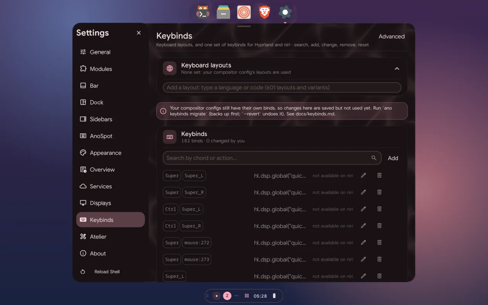

# Keybinds

AnoShell keeps **one keybind set** for every compositor. Each bind maps a key
chord to an action. From that set anod writes Hyprland's and niri's bind files,
so a chord does the same thing on both.

- **Neutral actions:** close a window, focus or move left/right/up/down, go to
  or move a window to workspace N, toggle a shell panel, run a command, and so
  on. On Hyprland they render as `hl.bind(…)`, on niri as `binds { … }`.
- **Compositor-only actions:** a niri column operation or a Hyprland global
  shortcut are kept as that compositor's own action and generated only there.
  `ano keybinds list` shows which compositor each bind is for.



## Keyboard layouts

The **Keyboard layouts** card at the top of Settings → Keybinds lists the
XKB catalogue (`/usr/share/X11/xkb/rules/evdev.xml`, from
xkeyboard-config): type a language or a code (`fr`, `azerty`) and click one
to add it. Your layouts are kept in order in `keyboard.layouts`
(`[{"layout": "fr", "variant": "azerty"}]`); the first is the default, and
the `keyboard` bar/pill module switches between them (click: next,
right-click: previous).

anod (`keyboard.apply`) checks each against the catalogue and applies them:

- **Hyprland**: live, with `hyprctl eval` of `input`'s `kb_layout` and
  `kb_variant` only, and in `~/.config/hypr/ano-managed.lua`.
- **niri**: in `~/.config/niri/ano-managed.kdl` (an `input { keyboard { xkb } }`
  block; niri merges it into yours field by field and reloads it).

The managed files only count once your compositor config loads them (at the
end, so they win). An empty list leaves your compositor config's layouts
alone. `keyboard.catalogue` returns the catalogue as
`[{"layout", "variant", "short", "description"}]`.

## The defaults

The shipped set (`anod/internal/keybinds/defaults.json`) is curated by hand
from your Hyprland and niri binds: cleaned up, the waybar/rofi/swaync/wlogout
era replaced by the shell, and one meaning per chord on every compositor.

| Keys | Does |
|---|---|
| Super (tap), Super+A | search; Super+Tab overview; Super+Grave task view |
| Super+B / N / I / O / X | left sidebar / right sidebar / control panel / media / session |
| Super+Y | Scratchpad & Pins (when on) |
| Super+Alt+P | live pin: keep part of a window on screen (Hyprland) |
| Super+Comma, Super+Slash | Settings, cheatsheet |
| Super+Return, Super+E, Super+Z, Super+D | terminal, files, browser (your default apps), vicinae |
| Super+Q, Super+Shift+Q | close |
| Super+F / Super+Alt+F | maximize / fullscreen |
| Super+G or Super+W | tabs (a Hyprland group, a tabbed niri column) |
| Super+arrows or H/J/K/; | focus; with Shift: move; Super+Ctrl+arrows: resize |
| Super+[ / ] , Super+R, Super+Ctrl+F | column: pull in/out, width presets, fit (scrolling layouts) |
| Super+1…0 | workspace; with Shift: move there; with Alt: send there |
| Super+L, Ctrl+Alt+K | lock |
| Print / Shift+Print / Ctrl+Print / Super+Shift+S | screenshot: screen / region / window / region (a card offers copy, save, edit, delete) |
| Super+Shift+X, Super+Shift+R | region text (OCR) to the clipboard with a card (Add to note, Pin), record a region |

`go run ./cmd/keybinds-import [hyprland.lua niri.kdl]` (from `ano/anod`)
writes `anod/internal/keybinds/import-report.md`: what a migration of those
configs would replace and keep.

## Your changes

Your changes are kept apart from the defaults, in
`~/.config/anoshell/keybinds.json`, so new default binds still reach you:

```json
{
  "binds": [ { "chord": "Super+D", "action": "shell", "args": ["search", "toggle"] } ],
  "remove": [ "Super+Space" ]
}
```

A bind there replaces the defaults on its chord, on the compositors it applies
to (`"only": "hyprland"` or `"niri"` limits it). `remove` takes a chord away.

| Command | |
|---|---|
| `ano keybinds list [--json]` | the effective set |
| `ano keybinds apply` | regenerate `~/.config/hypr/ano-managed-binds.lua` and `~/.config/niri/ano-managed-binds.kdl` (and reload Hyprland) |
| `ano keybinds migrate --dry-run` | show what a migration would do; writes nothing |
| `ano keybinds migrate` | move the binds out of your configs (below) |
| `ano keybinds migrate --revert` | put your configs back exactly as they were |

anod's socket offers the same to Settings: `keybinds.list`, `keybinds.set`
(`{"chord", "bind" | null, "replace"?}`; a chord already in use answers a
`conflict` error naming what is bound there, unless `replace` is set) and
`keybinds.reset` (`{"chord"?}`; no chord resets everything).

The cheatsheet (Super+/) asks anod for `keybinds.active`: what the running
compositor binds right now (ano's set once migrated, else your own config,
read the same way), grouped and searchable, plus the AnoShell actions that no
key triggers.

## Migration

Until you migrate, your compositor configs keep their own binds and the
generated files are unused. `ano keybinds migrate`:

1. Backs up `~/.config/hypr/hyprland.lua`, any file it `require`s that has
   binds, and `~/.config/niri/config.kdl` (next to them, with a timestamp).
2. Keeps your binds on chords the defaults leave free as your changes, for
   that compositor. On chords the defaults bind, the defaults win; the report
   lists each one (what it does now, what it did), and Settings → Keybinds
   puts any back.
3. Removes the bind statements from those files (Hyprland `hl.bind` calls,
   niri's `binds {}` block) and adds one include line at the end of each.
4. Writes the managed files and reloads Hyprland. niri picks up the included
   file itself.

`--revert` restores the backed-up files byte for byte.

Reading a Hyprland config runs it with the `lua` interpreter against a
recording stand-in for `hl`, so loops and helper functions are understood.
Binds whose action is a Lua function are carried over as written, together
with the local helpers they use.
