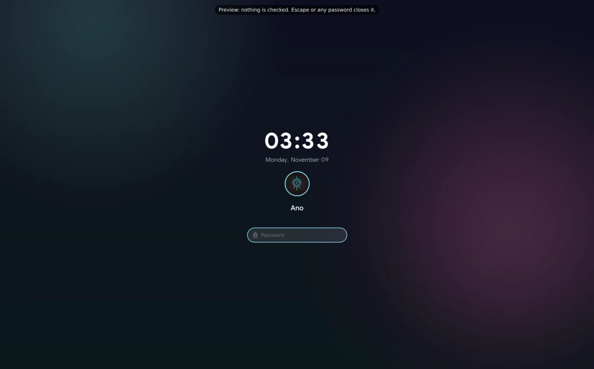
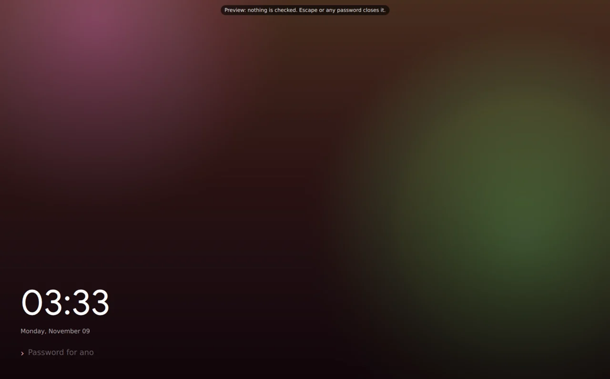
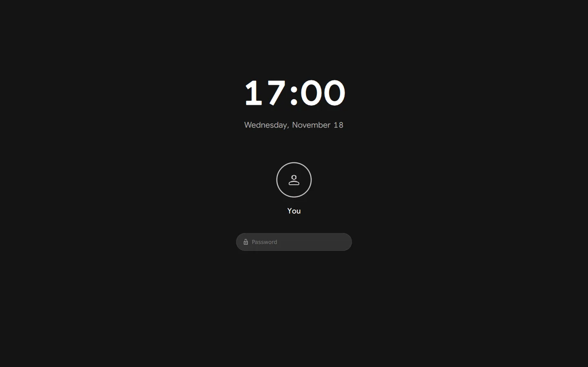

# Lock screens

AnoShell locks the session itself (`lock.locker` `"shell"`, the default) on
every compositor with the ext-session-lock protocol (Hyprland, niri, sway,
labwc, mango): **Super+L**, `qs -c ano ipc call lock lock`, and
`loginctl lock-session` (the session menu, idle tools). The protocol keeps
every screen covered even if the shell stops; the password is checked by PAM's
`login` service, faillock included. A compositor that refuses the lock (another
locker holds it, or no protocol) gets a notice after 5 s and nothing stays
locked.

With `lock.locker` `"external"`, `qs -c ano ipc call lock lock` runs
`lock.externalCommand` (`hyprlock` unless you change it) and the shell only
previews its lock screens.

**Hyprland with your own config.** The bundled config binds Super+L and
Ctrl+Alt+K to `qs -c ano ipc call lock lock` (hyprlock when the shell isn't
running). If yours still runs hyprlock, point the bind there, and in
`hypridle.conf` use:

```
general {
    lock_cmd = qs -c ano ipc call lock lock
    before_sleep_cmd = loginctl lock-session
}
```

The lock screen itself is replaceable: pick one in **Settings → General →
Lock screen** or **Settings → Atelier → Lock screens** (`lock.screen`, `default`
for the built-in one).

| Where | |
|---|---|
| `lockscreens/<id>/` in the shell | bundled |
| `~/.config/anoshell/lockscreens/<id>/` | yours; the same id overrides a bundled one |
| `~/.config/anoshell/lockscreens/<id>~<n>/` | installed from a catalog |

Bundled: **Simple** (the clock, your picture and name, and a field that's
always ready for typing: Enter submits, Esc clears; over the blurred wallpaper,
which sharpens a little while you type; after the right password everything
slides up and away), **Minimal** (a large clock on your wallpaper and one line
to type on) and **Bioma Gate** (Bioma's lock screen: a large clock with a
minute dial, your picture and name, one field; ported from Bioma, GPL-3.0).

With more than one screen, the field you type in is mirrored as dots on the
others (the built-in one and Minimal): only the number of characters is shared
between screens, never the text.





## Intros

**Settings → General → Lock screen → Lock intro** (`lock.intro`) plays one as
the session locks, under a second, on every lock screen:

- **Waves**: coloured waves sweep down over the desktop as it was and open onto
  the lock screen. When the [corner revolver](configuration.md)'s Lock fired,
  they sweep diagonally from the corner its bullet flew to.
- **Padlock**: a padlock spins and grows while the lock screen shows through.
- **Portal**: a spinning ring grows from the centre, the lock screen inside it.

The desktop "as it was" is a still of each screen taken just before locking
(Quickshell's screencopy: the compositor needs `wlr-screencopy` or
`ext-image-copy-capture`); without one, the wallpaper stands in. Taking it holds
the lock back at most 0.4 s. Intros are skipped while animations are off or
reduced motion is on, and after a restart that locks again. The intros and Simple were inspired by
Anserin's lock screens (reimplemented, no code copied).

## Fingerprint

With **Fingerprint unlock** on (`lock.fingerprint.enable`, off by default)
and a print enrolled with fprintd (`fprintd-enroll`), touching the reader
unlocks too. It runs beside the password check, never instead of it: the
password always works, and after `lock.fingerprint.maxTries` (3) failed
scans only the password does until the next lock. A scan that times out with
no finger starts again; a reader that stops answering is retried with
growing pauses. The fingerprint check is the shell's own PAM service
(`modules/lock/pam/fprint`) without faillock, so a finger unlocks even while
too many wrong passwords have the password locked out, and failed scans don't
count towards that lockout. Previews never scan. If your PAM `login` stack
also has `pam_fprintd` (`/etc/pam.d/system-auth`), a password check may find
the reader busy with this scan; PAM then moves on to the password.

## Arranging

The built-in lock screen and Simple can be arranged (packages opt in, see
below). **Settings → General → Lock screen** shows the chosen one in miniature:
drag an element anywhere, or click one and drag its round handle to resize it.
**Edit layout** (or `qs -c ano ipc call lock editLayout [id]`) opens the
full-screen editor on the focused screen:

- drag to move: elements snap to the centre lines and to the other elements'
  edges and centres, or to the grid (**G**);
- the round handle resizes; **R** turns the selected element by 90°; the slider
  sets its opacity; **Delete** removes it (not the password field: without it
  nothing unlocks);
- **+** adds the clock, your picture, your name, the keyboard layout, the
  battery, the notifications that arrive while locked (with
  `lock.notifications.enable` on), or any installed desktop piece (shown, never
  touched: it takes no input on the lock);
- arrows nudge (Shift: 10 px); **Ctrl+Z** / **Ctrl+Shift+Z** undo and redo;
  the reset button goes back to the lock screen's own arrangement;
- **Enter** or Done saves, **Escape** or Cancel leaves it as it was. Nothing
  typed is checked.

Layouts are saved per lock screen as `lock.layouts.<id>`: a list of elements,
each centred at fractions of the screen and sized against a 1080 px tall
screen, so the same layout fits any resolution (an element is kept whole on
screen when it fits):

```json
"lock": { "layouts": { "simple": [
  { "uid": "clock", "type": "clock", "x": 0.2, "y": 0.15, "scale": 1.3, "rot": 0, "opacity": 1 },
  { "uid": "field", "type": "field", "x": 0.5, "y": 0.66, "scale": 1, "rot": 0, "opacity": 1 },
  { "uid": "piece-day-progress", "type": "piece", "x": 0.8, "y": 0.8, "scale": 1, "rot": 0, "opacity": 0.8,
    "settings": { "id": "day-progress" } }
] } }
```

Types: `clock`, `avatar`, `name`, `field`, `keyboard`, `battery`,
`notifications`, `piece` (`settings.id` names it). **Reset layout** in
Settings removes a lock screen's entry. The built-in one keeps its centred
column (with the status row and on-screen keyboard) until you arrange it; an
`lock.layout` from before is moved into `lock.layouts.default` once.

## Preview

**Preview** (Settings or the Atelier) or `qs ipc call lock preview <id>` shows a
lock screen on the focused screen without locking. Nothing is checked:
Escape, any password, a minute or `qs ipc call lock endPreview` closes it.

## Never locked out

The shell falls back to the built-in lock screen when the chosen one:

- doesn't compile, or its manifest is invalid;
- fails to load, or isn't ready within 3 seconds;
- has no `ctx` property (it couldn't take a password).

**Ctrl+Shift+Escape** on a locked screen also switches to the built-in one,
for a lock screen that draws but doesn't let you type (unless it takes every
key itself). In a preview on Hyprland the compositor's own Ctrl+Shift+Escape
bind gets the key first.

If the shell itself stops while locked, the screens stay covered: that's the
protocol doing its job, and it means nothing can unlock them until a locker
takes over. The restarted shell locks again (the marker above); whether niri
hands the covered screens to it hasn't been tested yet. From another TTY (Ctrl+Alt+F2) you can always end the
session with `loginctl terminate-session <id>` (`loginctl list-sessions`
shows it), which closes your apps.

## Making one

A folder with `lockscreen.json` (`id`, `name`, `description`, `author`,
`version`, `entry`, as for [launcher plugins](plugins.md); optionally
`preview`, a picture in the folder for the Atelier's card) and the entry QML
file. Its root `Item` fills the screen and gets `ctx`:

| `ctx.` | |
|---|---|
| `submit(password)` | check this password; unlocks when it's right |
| `failed()` | signal: the password was wrong (clear your field) |
| `reportTyped(length)` | call from your field when its text changes (if it has focus or is empty) and when it gains focus: only the length is shared |
| `typedLength` | the length the focused screen's field reported, the same on every screen: draw that many dots where your field has no focus |
| `busy` | a check is running |
| `error` | why the last try failed (`""` when none) |
| `capsLock` | Caps Lock is on |
| `user`, `avatar`, `wallpaper` | the user name, `~/.face` and the wallpaper as `file://` URLs |
| `screen` | the screen this copy covers (one per screen) |
| `preview` | shown as a preview: nothing is checked |
| `fingerprint` | `{ available, state, tries, maxTries, message }`: whether a fingerprint also unlocks (`state` `"off"`, `"scanning"`, `"fail"`, `"max"` or `"error"`); to show only, the shell runs the scan |
| `layout` | the elements to draw, for a lock screen that supports layouts (below) |
| `wantOutro(ms)` | ask for up to 600 ms between the right password and the lock going away |
| `leaving` | the right password went in: play your outro now (only after `wantOutro`, and not with animations off or reduced) |

**Layouts.** A lock screen supports them by bringing its own arrangement as
`layout` in `lockscreen.json` (a list of elements as above). `ctx.layout` is
then the saved one or yours; draw it with the shell's own elements:

```qml
import qs.modules.lock
LockElements { anchors.fill: parent; focus: true; ctx: root.ctx; elements: root.ctx.layout }
```

(see `lockscreens/simple/` for a whole one).

Give your password field `focus: true`. Unlocking is never the lock screen's
job: it only draws and calls `ctx.submit()`. The shell holds the lock itself
until PAM accepts a password; setting `GlobalStates.screenLocked` or changing
`lock.enable` while locked doesn't release it, and neither does reloading the
shell (a crash leaves a marker in `$XDG_RUNTIME_DIR/ano/locked`, and the
restarted shell locks again).

```qml
import QtQuick

Item {
    property var ctx
    Rectangle { anchors.fill: parent; color: "#101014" }
    TextInput {
        id: field
        anchors.centerIn: parent
        width: 300
        focus: true
        echoMode: TextInput.Password
        color: "white"
        onAccepted: ctx.submit(text)
    }
    Connections { target: ctx; function onFailed() { field.text = "" } }
}
```

Like pieces and plugins, a lock screen runs with the shell's rights, so it
could still do anything the shell can: install only ones you trust. From a
catalog the Atelier checks it first, flags code that touches the lock state, the
session lock or PAM, and asks (see [Atelier](atelier.md)).
