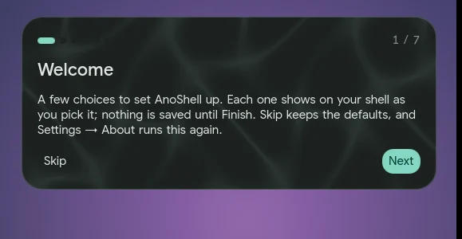

# Welcome, presets and customizing

## The welcome wizard



The first time AnoShell starts with an empty user config, a short wizard
opens beside the shell. It covers:

- the panel family;
- the bar: the pill or a full bar, and which edge;
- the look and light or dark;
- the wallpaper folder;
- display and cursor;
- a check of your keybinds on the running compositor.

Each choice shows on your real shell as you pick it, and nothing is saved
until **Finish**. Enter moves to the next step.

**Skip** (or Esc) keeps the defaults and only records that you've seen the
wizard (`onboarding.seen`), so it won't open again. Run it again any time with
`ano welcome` or Settings → About → **Run welcome again**.

## Presets

Settings → About → **Presets** holds whole setups: family, bar style, look and
glass.

| Preset | |
|---|---|
| Liquid Pill | the pill is the bar, in the Liquid look |
| Classic | a full bar along the edge, in the Ink look |
| Minimal | bar and essential overlays only |
| Glass | the pill bar, with panels and cards in glass |

**Preview** shows a preset live without writing anything. **Cancel** puts
everything back exactly, and **Apply** keeps it. Leaving the page while
previewing also cancels.

- **Export my settings** saves every key you have changed as a preset in
  `~/.config/anoshell/presets/`. Keys that look like credentials are left out
  (API keys live in `secrets/` anyway).
- **Import** takes a preset file's path, checks it, and copies it in.

A preset is plain JSON. Here is the bundled Glass preset:

```json
{
  "name": "Glass",
  "description": "The pill bar, with panels and cards in glass over your wallpaper",
  "icon": "blur_on",
  "values": {
    "panelFamily": "ano",
    "bar.style": "pill",
    "appearance.look": "liquid",
    "appearance.glass.enable": true
  }
}
```

The bundled presets live in `ano/presets/`. Yours sit next to them in the
list, marked "yours".

## Displays

See [Displays and cursor](displays.md).
