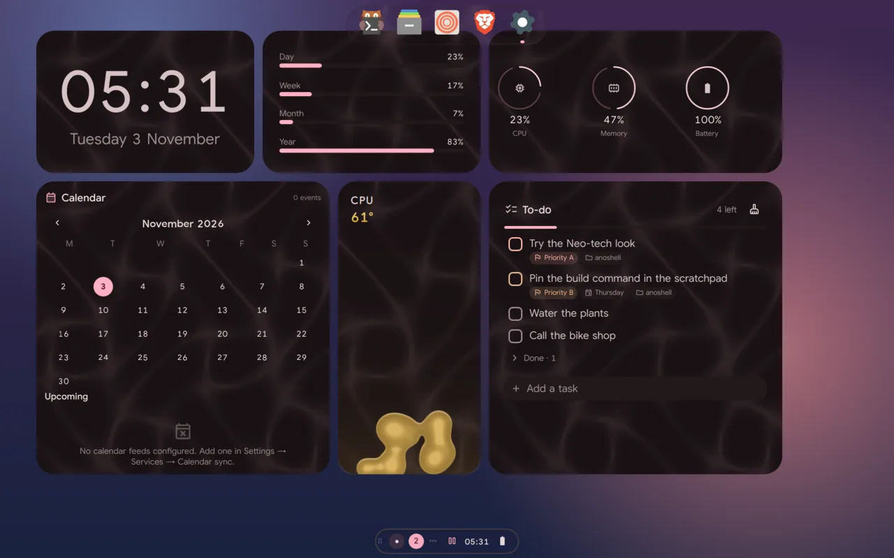

# Pieces

Pieces are AnoShell's desktop widgets: cards on the desktop, over the wallpaper and under every window, laid out on
a grid in pages. Off by default (`pieces.enable`): until you turn them on in
**Settings → Modules → Desktop pieces** there is no piece surface and no
piece code runs.



## Using them

- **Add**: in edit mode (below), or the Desktop pieces card in Settings, which lists every piece (the bundled ones and
  yours) with **Add**, which puts it on the shown page of the chosen screen at
  the first free spot. A piece that's broken is listed with its error and
  can't be added.
- **Pages**: with more than one page, arrows at the screen's edges and dots at
  the bottom switch them; so do a horizontal drag across a piece, a
  two-finger touchpad swipe, and keys you bind to
  `qs ipc call pieces next` / `prev` / `page N` (the focused screen).
  Only the shown page's pieces exist; the new page's fade in (in edit mode,
  pages slide).
- **Grid**: `pieces.cell` (the square, 96 px) and `pieces.gap` (12 px).
  The layer fills the area your bars leave free and centres whole cells in it.
- The layout is kept per screen in `pieces.screens`:
  `{ "eDP-1": { "page": 0, "pages": [[{ "uid", "id", "x", "y", "w", "h", "settings" }]] } }`,
  positions and sizes in cells.

Clicks only reach a piece's card and the page controls; anywhere else they go
to the desktop, and a window over the pieces gets its own clicks. Pieces
pause while the screen is locked or a maximised/fullscreen window covers it.
A tiled window covering the desktop isn't detected (niri doesn't report where
tiled windows are); the window hides them, but their timers keep running.

## Built-in pieces

| Piece | Shows | Settings |
|---|---|---|
| Clock | the time, large, with the date | seconds |
| Profile | your picture (`~/.face`), name, uptime, a status line; lock, settings, power | status, picture |
| Weather | current weather; today's hours and the next days when tall enough (wttr.in, the city from Settings → Bar → Weather) | hourly, daily |
| Media | cover, title, artist, controls (the sidebar's media card) | |
| Photo frame | a picture, or a folder's pictures in turn | path, interval, shuffle |
| System | CPU, memory, battery; CPU temperature and disk use of `/` if you want them | temperature, disk |
| Timer | focus (Pomodoro), stopwatch or countdown: the same timers as the sidebar's | mode |
| To-do | your tasks: the sidebar's to-do and `todo.txt`, both ways | |
| Calendar | the month with your events and holidays | |
| Clock faces | Zen, Plain, Terminal or Cosmos: clocks from dhrruvsharma's dotfiles (GPL-3.0) in your colours and time format, scaled to the piece | face |
| Day progress | how far through the day, week, month and year, as bars | week start |
| News | headlines from Google News RSS (no key; personal use under Google's terms), opened in the browser on click; refreshed every 30 minutes. The local feed sends the place you type to Google | top / topic / local, place, country, language |
| Lyrics | synced lyrics of the playing track, the current line in the middle and emphasised; click a line to seek. Needs Settings → Services → Lyrics; says so when it's off, nothing plays, or the track has none | title and artist |
| World clock | the time in several places, with the difference, +1/−1 when it's another day there, and a day/twilight/night icon. One column per place when wide, a row each otherwise | places (`Area/City=Label`, comma-separated; empty: the Clock panel's world clocks) |
| Palette | the Material colours made from your wallpaper as swatches: a row per family when roomy, the key colours when small. Click one to copy its hex | hex on the swatches |
| Screen time | today's total and top apps as bars, as many as fit; the last 7 days when tall (the sidebar's screen time card). Needs screen time on (Settings → Sidebars) and anod | last 7 days |

The to-do and timer pieces keep their service running while they're placed,
even with the sidebar's to-do or Pomodoro turned off. The lyrics piece only
looks lyrics up while the desktop can be seen; the world clock's offsets come
from the Clock panel's service (`date` per zone, checked hourly for DST).

## Bioma organisms

The `bioma-*` pieces are Bioma's desktop "organisms" (GPL-3.0), ported:
clock, weather, photoperiod (sun and moon), calendar, agenda, media (with
the audio band), vitals, lava (CPU temperature), nucleus (battery),
osmosis (network), cytoplasm (apps by memory), adipose (disks), vacuole
(unread notifications), sediment (recent files), growth rings (active
time) and note (a Markdown file). They draw as in Bioma, in AnoShell's
colours, and only run while the desktop can be seen.

Their support code is `pieces/_bioma`: Bioma's Metrics, Timing,
Typography, Theme (roles from AnoShell's palette) and components, and its
services as they were or adapted onto AnoShell's (notifications, calendar,
the countdown, the spectrum). Weather uses the bar's city (or the one the
bar's weather found) with Open-Meteo, in °F when the bar uses US units.
Activity data is kept in `~/.local/state/anoshell/activity.json`.

Cost: the moving organisms are stepped at `pieces.fps` (10 by default,
Settings → Modules → Desktop pieces), not at the display's rate, and each
redraws only its own card; see Resource use below.

Known limits: the media band is mono (both halves show the same spectrum);
the vitals GPU ring needs an AMD card; cytoplasm groups processes by their
ancestor (window pids aren't exposed yet); the note's default file is
`~/notes.md`.

## Resource use

Measured with `scripts/dev/budget.sh` (average CPU of one core over 30 s,
after 30 s settling, each piece alone) on the reference laptop (i7, Intel
Iris Xe, its own 1920×1200 panel at scale 1.5), Liquid look, `pieces.fps` 10
(the default). The shell idles at 0.0% with pieces off or with no moving
piece. Memory: the layer and registry add about 50 MB; each piece a few MB.

| Piece | CPU | Moves? |
|---|---|---|
| AnoShell clock (seconds on) | 0.5% | once a second |
| AnoShell clock, profile, weather, to-do, calendar, timer (stopped), news | ~0% | no (news: one curl every 30 min) |
| World clock, palette, screen time | not measured yet; nothing of their own ticks (the world clock follows the Clock service's minute) | no |
| Lyrics | not measured yet | the current line, while a track with lyrics plays |
| Bioma clock | 0.6% | second hand, once a second |
| Bioma weather, photoperiod, agenda, calendar, adipose, sediment, rings, note | 0–1% | no |
| Bioma nucleus | 0.4% (more while charging) | while the battery changes |
| Bioma vacuole | ~0% (more with unread) | while there are unread notifications |
| Bioma osmosis | 1.0–1.3% | while traffic flows |
| Bioma lava | 2.1–2.3% | continuously (its speed is the CPU temperature) |
| Bioma vitals | 3.1% | heartbeat (CPU), RAM wave |
| Bioma cytoplasm | 3.1–3.3% | continuously (apps by memory) |

What a moving piece costs is mostly per frame, and the same for any piece:
about 0.25–0.3% of a core per frame a second (2.5–3 ms a frame: the
surface's commit and the GL driver; Qt's own render is under 1 ms). So the
cost follows `pieces.fps`: at 20 fps vitals and cytoplasm took about 6%, at
1 fps 0.5% and 1.1%. On top of that cytoplasm reads every process every 3 s
(about 0.9% on its own; that is its data). Every organism ticks on one
shared clock (one redraw per tick however many parts move), cytoplasm works
out each cell's shape once a frame, and the app grouping looks names up once
per sample; together these moved the totals by less than the measurement
noise, since the per-frame cost sits below the shell. The three that move all
the time are over the shell's 1% idle budget by design: their motion is the
reading. For a quieter desktop, lower `pieces.fps` or leave them off.
Everything pauses under a maximised window or the lock screen. At rest each
piece is its own small surface, so only a moving piece's card is redrawn.

## Edit mode

Right-click a piece, press **Edit on the desktop** in Settings, or run
`qs ipc call pieces edit`. The layer comes above your windows and shows the
grid:

- drag a card to move it: a shape under it shows where it will land, the
  cell you let go on or, when that's taken, the nearest free spot it fits
  (it springs back only when the page has no room for it);
- drag its corner to resize it: the pieces it grows into are pushed right or
  down just far enough (pushing the next one on in turn), and one that hits
  the edge goes to the nearest free spot. You see them move while you drag.
  When nothing more fits, the size stops at the last one that did (never
  under the piece's `minSize`);
- keys: click a card (or press Tab) to select it; the arrows move it a cell,
  pushing what's in the way, and Shift+arrows resize it from its bottom-right
  corner. The layer takes the keyboard once you click on it;
- every move and resize can be undone from the toast (or
  `qs ipc call undo last`) for a few seconds, as long as the page hasn't
  changed since;
- **×** removes it, **⚙** opens its settings (from its manifest);
- the toolbar adds a piece (at the first free spot), adds or removes a page,
  and **Done** leaves; so does Escape (or `qs ipc call pieces done`).

Everything is saved as you go, per screen, in `pieces.screens`.

## Making a piece

A piece is a folder in `~/.config/anoshell/pieces/<id>/` with a manifest and
a QML file. The shell watches the folder: a new piece shows up in the list
without a restart, and editing `piece.json` reloads it. A piece with the id
of a bundled one replaces it.

`piece.json`:

```json
{
  "id": "hello",
  "name": "Hello",
  "description": "Says hello",
  "author": "you",
  "version": "1.0.0",
  "entry": "main.qml",
  "size": { "w": 2, "h": 1 },
  "minSize": { "w": 1, "h": 1 },
  "frame": true,
  "settings": [
    { "key": "greeting", "type": "string", "label": "Greeting", "default": "Hello" }
  ]
}
```

- `id` must match the folder name (or be left out). `name` is required.
- `entry` defaults to `main.qml`; it must be a file in the folder.
- `preview` (optional): a picture in the folder (or an https URL from a
  catalog) that the Atelier shows on the piece's card.
- `size` and `minSize` are in grid cells (1–12).
- `frame: true` (the default) draws the card behind your QML, in the active
  look's colours, with a 12 px inset; `false` gives your QML the whole cell
  area and no card.
- `settings` describes the piece's options (`bool`, `int`, `real`, `string`,
  `choice` with `options`); each placed piece's values are in its `settings`.

The entry file's root item fills the card. The host sets two properties on it
if it declares them:

```qml
import QtQuick
import qs.modules.common
import qs.modules.common.widgets

Item {
    property var ctx        // { live, screenName, cell }
    property var settings   // the manifest defaults, overridden by this piece's values

    Timer {
        running: ctx?.live ?? false   // only while the desktop can be seen
        interval: 1000; repeat: true
        onTriggered: ...
    }
    StyledText {
        anchors.centerIn: parent
        text: settings.greeting
        color: Appearance.colors.colOnLayer1
    }
}
```

The shell's own modules are importable (`qs.modules.common` for `Appearance`
and `Config`, `qs.modules.common.widgets`, `qs.services`). Bind every timer,
animation and poll to `ctx.live`: that is what keeps the desktop free when
nobody can see it.

A piece whose manifest is invalid or whose QML doesn't compile is listed with
the error (`Broken.qml:2:38: Cannot assign to non-existent property "colr"`)
and isn't placed; one that fails later shows the reason in its card. The rest
keep working.

`qs ipc call pieces list` prints every piece with its source and errors;
`qs ipc call pieces add <id>` puts one on the focused screen's shown page
(what the Atelier's **Add to desktop** does from the standalone Settings
window); `qs ipc call pieces remove <id>` takes the first one of that id off
the focused screen's shown page, with Undo; `qs ipc call pieces grid` shows
each screen's grid.

For scripts, columns and rows count from 1:

- `qs ipc call pieces place <id> <col> <row>` puts a piece on the focused
  screen's shown page at that cell, or the free spot nearest it, and prints
  its uid;
- `qs ipc call pieces move <uid> <col> <row>` moves a placed piece (on any
  screen and page; the uids are in `pieces.screens`) the same way, with Undo.

The arranging itself (nearest free spot, pushing, the resize limit) is in
`services/piecesArrange.js`; `node scripts/dev/test-pieces-arrange.js`
checks it.
