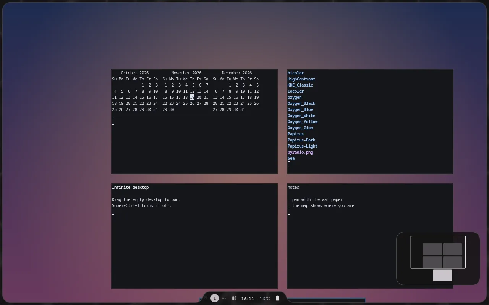

# Scrolling workspaces and the infinite desktop

Settings → Overview has two cards for how a workspace lays out its windows.

## Scrolling workspaces

Windows sit in columns on a strip wider than the screen. Everything here goes
through anod's managed compositor file, so your own config is never edited.

| Compositor | What the settings do |
|---|---|
| Hyprland | The workspaces you pick use Hyprland's built-in scrolling layout, in the direction you pick. The column width and per-app widths (`scrolling_width` window rules) apply too. Changes apply straight away (`hyprctl eval`), and the managed file `~/.config/hypr/ano-managed.lua` keeps them for the next start once your `hyprland.lua` loads it (`ano keybinds migrate`, or the `dofile` line in [displays](displays.md)). |
| niri | Every workspace already scrolls. The column width becomes `layout { default-column-width }` and per-app widths become window rules in `~/.config/niri/ano-managed.kdl`. niri reloads it by itself once your `config.kdl` includes it. |
| mango | The tags you pick use the `scroller` layout (`vertical_scroller` for Down). The width goes to `scroller_default_proportion` and per-app widths to `window_rule=scroller_proportion`, all in `~/.config/mango/ano-managed.conf`. The bundled config sources it, and anod reloads mango after each change. |
| sway, labwc, Umbriel | No scrolling layout: the card says so. |

Config (`scrolling`):

```json
"scrolling": {
  "workspaces": [{ "id": 3, "direction": "right" }],
  "columnWidth": 0.5,
  "apps": [{ "app": "firefox", "width": 0.8 }]
}
```

Notes:
- `columnWidth` is a share of the screen width; 0 keeps the compositor's own default.
- Per-app widths apply to new windows of that app id (Hyprland: class).
- Turning a workspace off on Hyprland returns it to your default layout (`general.layout`) and switches off the app rules, all without a reload.

## Infinite desktop

The workspace's windows all float on a canvas that you pan around. The idea comes
from Anserin.



| | Hyprland | niri, sway, mango |
|---|---|---|
| On / off for the focused workspace | tap Super+Ctrl (press Super first), or Super+Ctrl+I | Super+Ctrl+I |
| Pan | drag the empty desktop; or hold Super+Alt and drag anywhere | drag the empty desktop; or Super+Alt+G, then move the pointer (a click or Esc ends it) |
| Edge push | drag a window against a screen edge | — (the shell can't read the pointer there) |

How it behaves:
- **Turning it on** floats every window where it is. Turning it off tiles them all again; windows that were off screen come back to the middle first.
- **While panning**, a small map in the corner shows the windows and the part of the canvas on screen.
- **Super+arrows** keep their usual meaning: the compositor focuses the nearest window in that direction, and the shell then pans the canvas until that window is in view. Clicking a half-visible window brings it in too.
- **A new window** opens floating in the middle of the screen, at no more than 60 × 70 % of it.
- **Arrange** (Settings, or `qs -c ano ipc call infiniteDesktop arrange`) spreads the windows out without overlap, centred on the screen.
- **Several screens:** Hyprland and sway would draw a window on the next screen once it slides there, and sway would even move it to that screen's workspace. So the shell parks such a window past every screen and brings it back when the canvas returns.
- **niri and mango** never let a floating window leave the screen: niri keeps a sliver (10–75 px) of it on screen, and mango puts it back at the left edge, so the shell keeps 40 px of each on screen there. Windows off the canvas wait at the edges and return to their places when you pan back.
- **niri** tells the shell only the column and row of a tiled window, not where it is, so turning the desktop on lays the columns out side by side as niri shows them (16 px gaps) with the focused one in view.
- **State:** which workspaces are infinite desktops, and where parked windows wait, is kept in `$XDG_STATE_HOME/anoshell/infinite-desktop.json`. It survives a shell restart in the same compositor session; a new session starts fresh.
- labwc and Umbriel can't float and move other windows over IPC, so the card shows the feature as unavailable there.

IPC (`qs -c ano ipc call infiniteDesktop …`): `toggle`, `arrange`, `pan <dx> <dy>`,
`panKeys` / `panKeysEnd` (held keys), `panKeysToggle`, `status`.

How it works: `services/InfiniteDesktop.qml` keeps the canvas, and `services/infiniteModel.js` does the arithmetic
(tested by `node scripts/dev/test-infinite-model.js`). The backends add `canvasState`, `floatWindows`,
`placeWindows` and `tileWindows` (see `services/compositor/BackendContract.md`). On Hyprland, each frame of a pan is
one `eval` request that moves every window, and a new one is only sent once the previous has been answered.
